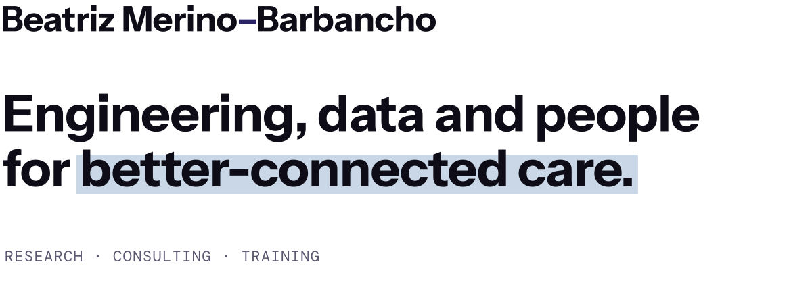

<picture>
  <source media="(prefers-color-scheme: dark)" srcset="assets/banner-dark.svg">
  
</picture>

I am a biomedical engineer, researcher, lecturer and project manager in digital health and AI. I connect technological development with clinical priorities, patient needs and healthcare delivery.

### What I work on

- **AI and data.** Machine learning, explainable AI, natural language processing, generative AI and large language models. I also generate and evaluate synthetic health data.
- **Digital health.** Diabetes, treatment adherence, rheumatology, clinical decision support, care at home and care transitions.
- **Open innovation.** I involve patients and healthcare professionals in the design, implementation and evaluation of innovation.

### Selected work

- **EU projects.** Deputy coordinator of INCAP, Living Labs and Test Beds, Better@Home and BEAMER, on integrated care, patient empowerment, treatment adherence and the adoption of digital health.
- **Publications.**
  - `2026` [When the chatbot leaks: securing patient-facing medical AI](https://ai.nejm.org/doi/abs/10.1056/AIp2600583). *NEJM AI*.
  - `2026` [Jev in Medicine: a benchmark evaluation](https://arxiv.org/abs/2609.34024). arXiv preprint.
  - `2026` [Large language models in rheumatology-centered research](https://doi.org/10.1016/j.semarthrit.2026.152994). *Semin Arthritis Rheum*.
  - `2025` [Synthetic data generation in healthcare](https://doi.org/10.1016/j.ijmedinf.2024.105763). *Int J Med Inform*.
  - [Read the rest on Google Scholar →](https://scholar.google.com/citations?user=Rr1ufRkAAAAJ)

### Experience

- `2026–now` Senior Program Manager, Digital Health & Artificial Intelligence, BRIDG OÜ.
- `2025–now` AI Consultant & Researcher, independent.
- `2022–2026` Collaborating lecturer, UPM. Teaching in the Biomedical Engineering degree and master's.
- `2017–2026` R&D International Project Lead and Senior Researcher, LifeSTech group, UPM. I coordinated multidisciplinary teams in international projects on digital health, AI models and the adoption of health technologies.

### Academic background

- `2022` PhD in Biomedical Engineering, UPM. Thesis: a framework for patient empowerment through digital technologies in integrated, value-based diabetes care.
- `2018` MBA, UPM.
- `2017` Master's in Biomedical Engineering, Healthcare Technology Management and Innovation, UPM.
- `2016` Degree in Biomedical Engineering, Medical Imaging, UPM.

### Let's talk

To collaborate or to hire me as a consultant, [message me on LinkedIn →](https://www.linkedin.com/in/beatriz-merino-barbancho/)
